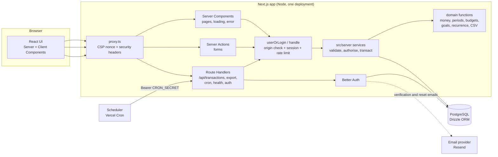
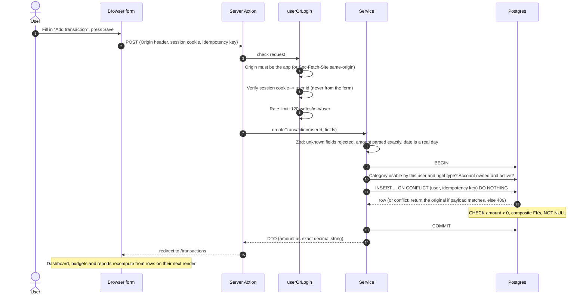
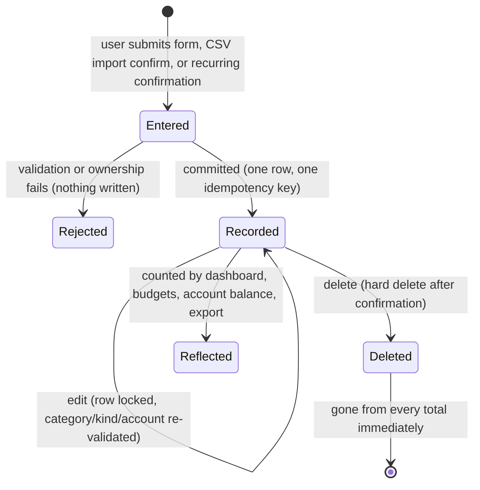
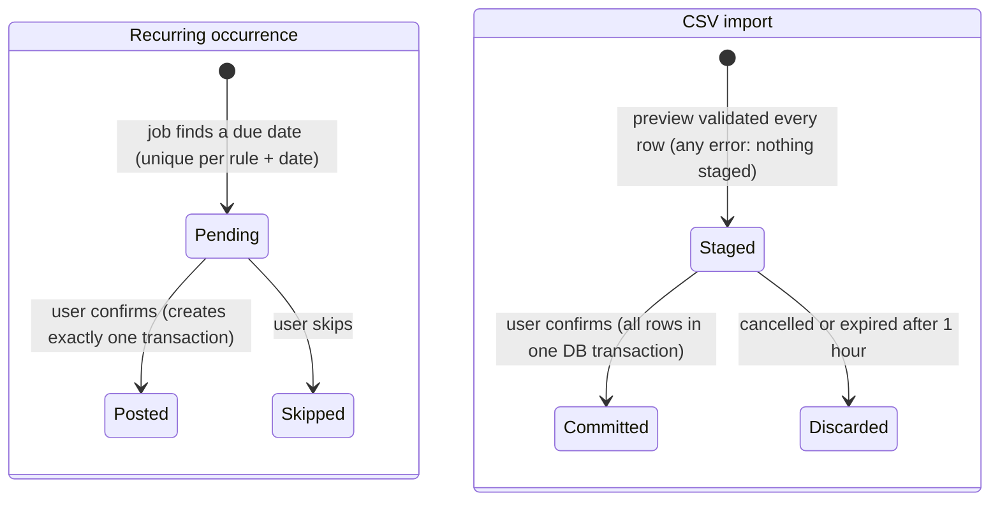
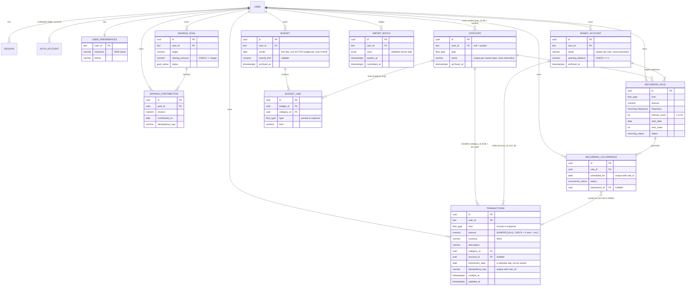

# Ispentit: architecture

How the system is built and why. Diagrams use [Mermaid](https://mermaid.js.org/) (rendered by GitHub and most Markdown viewers).
Behavioural detail per feature lives in [FEATURE-NOTES.md](FEATURE-NOTES.md); security in [SECURITY.md](SECURITY.md); operations in [DEPLOYMENT.md](DEPLOYMENT.md).

## 1. Principles

1. **One source of truth.** Every figure on screen is computed from transaction rows on read. Nothing is stored as a running total, so edits and deletes cannot leave a stale number behind.
2. **The server decides who you are.** A user id never comes from the client; every query filters by the session's user, and the database enforces key relationships too.
3. **Exact money.** Amounts are strings at the edge, BigInt minor units in code and `NUMERIC` in Postgres. No floating-point arithmetic touches a figure the user relies on.
4. **Say what is not known.** Balances are "recorded", goal contributions and recurring items are "planned", and nothing claims to be a bank figure.
5. **Every mutation is safe to repeat.** Idempotency keys, unique constraints and row locks make double submits and retries harmless.

## 2. System overview

There is no separate API service, queue, cache or search engine. Rendering is per request (no static or shared caching of private data) because the Content Security Policy needs a fresh nonce on every response.

## 3. Layers and directory map

| Layer | Where | Responsibility | May not |
|---|---|---|---|
| Presentation | `src/app/**/page.tsx`, `src/components` | Render, collect input | Touch the database or decide ownership |
| Request handling | `src/app/**/actions.ts`, `src/app/api/**/route.ts`, `src/server/http.ts`, `src/server/action-user.ts` | Origin check, session, rate limit, parse input, map errors | Contain business rules |
| Validation | `src/validators` | Zod schemas with explicit field allow-lists (unknown fields are rejected) | |
| Services | `src/server/*.ts` | Authorise, run the multi-step change in one DB transaction, return DTOs | Trust a client-supplied user id or total |
| Domain | `src/server/domain` | Pure, exhaustively tested functions: money, periods, budget and goal progress, recurrence, CSV, import rows | Do I/O |
| Data | `src/db` (schema, migrations, seeds) | Tables, constraints, indexes | |
| Cross-cutting | `src/lib` (env, errors, auth, mailer, format), `src/proxy.ts` | Validated config, safe errors, headers | |

## 4. How a write travels

### Lifecycle of a transaction

### Lifecycle of planned items (recurring, import)

Pending occurrences and staged imports are **not** transactions: they appear in no total, budget, balance or export until confirmed.

## 5. Data model

Also present and unconnected by foreign key: `verification` (one-time tokens, owned by the auth library), `rate_limit` (auth library counters) and `app_rate_limit` (application counters). The auth library's tables use text ids; all finance tables use UUIDs.

### Schema decisions

| Decision | Reason |
|---|---|
| `kind` is an enum on `transactions`; every income/expense query filters on it | A future `transfer` kind can be added without corrupting existing totals |
| Composite FK `(category_id, kind) -> category(id, type)` | A category of the wrong type cannot be attached even by a buggy or bypassed service |
| Composite FK `(account_id, user_id) -> money_account(id, user_id)` | An account that belongs to someone else cannot be attached |
| Partial unique index on `budget(user_id, month) where archived_at is null` | One active budget per month; archiving frees the month |
| `budget_line.type` pinned to `expense` with a composite FK | Income categories cannot be budgeted |
| `NO ACTION` (not `RESTRICT`) on category and account foreign keys | A category with history cannot be deleted, yet deleting a whole user still cascades |
| `ON DELETE CASCADE` on `budget_line -> category` | Found during testing: `NO ACTION` there broke account deletion because the cascade ordering differs for nested tables |
| Unique `(user_id, idempotency_key)` on transactions and contributions | Retries and double submits cannot duplicate money |
| Unique `(rule_id, scheduled_for)` on occurrences | The same scheduled date can never be generated twice |
| Categories, accounts, budgets and goals are archived, not deleted | History keeps its meaning |
| Indexes: `(user_id, transaction_date desc, id)`, `(user_id, category_id, transaction_date)`, `(user_id, account_id, transaction_date)` | The list, dashboard and category queries are all user-and-date scans |

## 6. Financial definitions

All amounts are in the user's currency (NGN). Periods are inclusive ranges of calendar days; the user's timezone only decides what "today" is.

| Metric | Definition |
|---|---|
| Income / Expenses (period) | Sum of `income` / `expense` rows with `transaction_date` inside the period |
| Net cash flow | Income - Expenses for the period. A surplus is **not** counted as money saved |
| Recorded balance | Opening balances of all accounts (archived included) + all-time income - all-time expenses. Not a bank balance |
| Account balance | Opening balance + income - expenses recorded against that account |
| Category total | Sum of expense rows per category in the period; share = category / total expenses (truncated to 2 dp) |
| Budget spent | Sum of expense rows in the budget's calendar month (overall: every category; a line: that category). Income, including refunds recorded as income, never reduces it |
| Budget status | On track below 80%; Approaching from 80%; Limit reached at exactly 100%; Over above. Remaining goes negative when over |
| Goal saved | Starting amount + contributions, never above the target. Contributions are planning records, separate from income and expenses |
| Set aside (dashboard) | Goal contributions dated inside the period; not deducted from the recorded balance |
| Series buckets | Daily for periods of up to 62 days, monthly otherwise; empty buckets are real zeroes |
| Monthly cash flow | The 12 calendar months ending with the month of min(period end, today) |

Rounding rule: input with more decimals than the currency allows is rejected, never rounded. Percentages are truncated to two decimals. Chart values are converted to JavaScript numbers **for drawing only**; every figure shown as text comes from exact strings.

## 7. Performance and caching

- **Aggregates in SQL.** The dashboard issues five parallel aggregate queries (period totals plus all-time in one `FILTER` query, account opening balances, category breakdown, series buckets, 12-month trend). Budgets use one grouped query for all months; goals and accounts use correlated subqueries; there are no per-row queries.
- **Bounded everything.** Page size at most 100; export at most 50,000 rows; import at most 2,000 rows and 512 KB; custom date ranges at most 10 years; contribution history 200; budget history 60; per-user caps on categories (100), accounts (20), goals (100) and rules (50).
- **Measured** (single laptop, local Postgres, one user): 100,000 transactions, full dashboard 107-180 ms, page 400 of the list 89 ms, text search with amount sort 89 ms. End-to-end tests also load a 1,500-row history, page through it, export it and reconcile the totals. These are not production figures and no multi-user load test has been run.
- **Caching.** Private pages and API responses are `private, no-store` and rendered per request. The only cached assets are the immutable build files. There is no shared cache of financial data.
- **Connections.** One `postgres` pool (max 10) reused across hot reloads and warm serverless invocations; use the provider's pooler for serverless.

## 8. Reference: HTTP routes

All private routes: session required (401), writes need `Origin` equal to the app (403), responses `private, no-store`, errors `{ "error": { "code", "message", "fields?" } }`.

| Method and path | Purpose | Limits and notes |
|---|---|---|
| `GET /api/transactions` | List. Query: `q`, `kind`, `categoryId`, `accountId`, `from`, `to`, `sort=date\|amount`, `dir`, `page`, `pageSize` | `pageSize` at most 100; unknown params 400 |
| `POST /api/transactions` | Create. Body fields: `kind, amount (string), description, categoryId, accountId?, transactionDate, notes?, idempotencyKey?` | 120 writes/min/user; body at most 16 KB; unknown fields 400; same key + same payload returns the original (201), different payload 409 |
| `GET /api/transactions/:id` | Read one | Another user's id is 404 |
| `PATCH /api/transactions/:id` | Partial update (allow-listed fields) | 404 for other users' ids |
| `DELETE /api/transactions/:id` | Delete | 404 for other users' ids |
| `GET /api/transactions/export` | CSV download (`Content-Disposition: attachment`) with the list filters | 5/min/user; refuses over 50,000 rows |
| `GET /api/health` | `{ "ok": true }` or 503 | Public, reveals nothing else |
| `GET /api/cron/recurring` | Generates planned recurring occurrences | `Authorization: Bearer $CRON_SECRET`; 503 if unset, 401 if wrong |
| `/api/auth/*` | Better Auth (sign-up, sign-in, verify, reset, sessions, delete) | Per-IP and per-email limits; external `callbackURL`s rejected |

Error codes: `VALIDATION` 400, `UNAUTHENTICATED` 401, `FORBIDDEN` 403, `NOT_FOUND` 404, `CONFLICT` 409, `RATE_LIMITED` 429, `INTERNAL` 500 (generic message only).

## 9. Reference: server operations (Server Actions)

Every action calls `userOrLogin()` (origin check, session, 120 writes/min). Import preview has its own limit of 10/min. A structural test fails the build if an action does not.

| Area | Actions | Service functions |
|---|---|---|
| Transactions | `createTransactionAction`, `updateTransactionAction`, `deleteTransactionAction` | `createTransaction`, `updateTransaction`, `deleteTransaction` |
| Import | `previewImportAction`, `confirmImportAction`, `discardImportAction` | `previewImport`, `confirmImport`, `discardImport` |
| Categories | `createCategoryAction`, `updateCategoryAction`, `setArchivedAction` | `createCategory`, `updateCategory`, `setCategoryArchived` |
| Accounts | `createAccountAction`, `updateAccountAction`, `setAccountArchivedAction` | `createAccount`, `updateAccount`, `setAccountArchived` |
| Budgets | `createBudgetAction`, `updateBudgetAction`, `archiveBudgetAction` | `createBudget`, `updateBudget`, `archiveBudget` |
| Goals | `createGoalAction`, `updateGoalAction`, `addContributionAction`, `deleteContributionAction`, `completeGoalAction`, `reopenGoalAction`, `archiveGoalAction`, `restoreGoalAction`, `deleteGoalAction` | `createGoal`, `updateGoal`, `addContribution`, `deleteContribution`, `completeGoal`, `reopenGoal`, `archiveGoal`, `restoreGoal`, `deleteGoal` |
| Recurring | `createRuleAction`, `updateRuleAction`, `pauseRuleAction`, `resumeRuleAction`, `deleteRuleAction`, `confirmOccurrenceAction`, `skipOccurrenceAction` | `createRule`, `updateRule`, `pauseRule`, `resumeRule`, `deleteRule`, `postOccurrence`, `skipOccurrence`, `generateOccurrences` |
| Settings | `savePreferencesAction`, `setThemeAction` | `updatePreferences` (name via the auth API) |

Read services used by pages: `getDashboard`, `listTransactions`, `getTransaction`, `listCategories`, `listBudgets`, `getBudget`, `getActiveBudgetForMonth`, `listGoals`, `getGoal`, `getSavingsSummary`, `listAccounts`, `listRules`, `listPending`, `countPending`, `exportTransactionsCsv`, `getPreferences`.

## 10. Decision records

| # | Decision | Why | Trade-off accepted |
|---|---|---|---|
| 1 | Next.js App Router with Server Actions and a few Route Handlers; no separate API | One deployable, no CORS surface, forms work before hydration | Business logic must stay out of components (enforced by layering and tests) |
| 2 | Better Auth with the Drizzle adapter | Maintained, covers verification, reset, sessions, deletion and rate limiting; no custom crypto | Newer library than Auth.js; its tables use text ids |
| 3 | `NUMERIC(18,4)` in Postgres, strings at the edge, BigInt in code | Exactness; property tests cover 2,000 random cases | Conversion helpers everywhere; charts need floats for drawing only |
| 4 | Transaction dates are `date`, not timestamps; timezone only decides "today" | No midnight off-by-one errors, no DST arithmetic | A transaction has no time of day |
| 5 | Totals computed on read, never stored | Edits and deletes can never leave a stale number | Cost grows with history; measured acceptable to 100,000 rows per user, add summary tables if it is not |
| 6 | Ownership by `user_id` in every query plus composite FKs; **no Postgres row-level security** | Simple and fully tested; RLS adds connection-pool complexity | A new query that forgets `user_id` is a bug; mitigated by tests and review, not by the database |
| 7 | Idempotency keys, unique constraints and row locks instead of a queue | Retries are safe without extra infrastructure | Clients must send a key for exactly-once creation |
| 8 | Recurring items are planned until confirmed | Never claims money moved because a date passed | One extra click per occurrence |
| 9 | Rate limits in Postgres | Works across serverless instances with no extra service | A write per limited request; per-IP limits depend on a trustworthy forwarded-for header |
| 10 | CSV import is preview then confirm, staged in the database | The client cannot alter what is committed; all or nothing | Staging rows live up to an hour |
| 11 | Dynamic rendering for every page with a per-request nonce CSP | Strong script policy; no private data in shared caches | No static page caching or CDN for HTML |
| 12 | Archive instead of delete for categories, accounts, budgets, goals | History keeps its meaning; reports stay stable | Archived rows accumulate |
| 13 | Plain Tailwind and native HTML controls | Fewer dependencies, native dialogs and selects are accessible and testable | Departs from the brief's suggested shadcn/ui; no shared component library |
| 14 | Native forms with `useActionState`, no React Hook Form | Server-side validation is the source of truth; forms work with simple state | Less client-side instant validation |

## 11. Feature status

| Feature | Status |
|---|---|
| Registration, verification, login, logout, password reset, sessions, account deletion | Implemented. Email delivery needs `RESEND_API_KEY` (untested against the real provider) |
| Transactions (CRUD, search, filter, sort, paginate) | Implemented |
| Dashboard, filters, charts with text equivalents | Implemented |
| Categories, budgets, savings goals | Implemented |
| CSV export and import | Implemented |
| Accounts with opening balances | Implemented |
| Recurring transactions | Implemented. Scheduler needs `CRON_SECRET` and a cron trigger (configured for Vercel, not tested there); also runs on page load |
| Themes, settings, legal pages | Implemented. Legal text needs a lawyer's review and the `LEGAL_*` variables |
| Transfers between accounts | **Not implemented**; the model leaves room (`kind` enum) |
| Multiple currencies, exchange rates | **Not implemented** (NGN only) |
| MFA, breach checks, security emails, audit log | **Not implemented** |
| Bank connections, notifications, mobile app | **Not implemented** |
