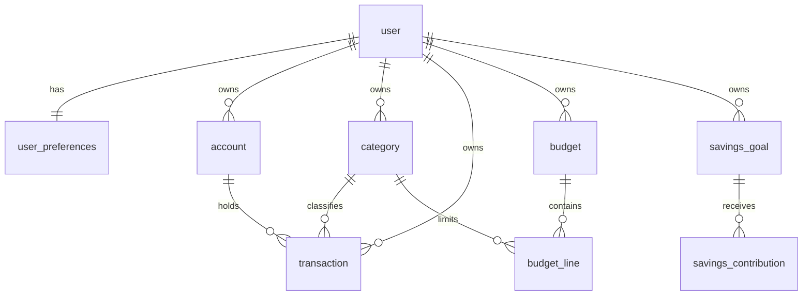

# Ispentit: Phase 1 Plan (architecture, no code yet)

> **Status (Phase 10): this was the Phase 1 plan and is now historical.** The application was built to it, with these differences:
> Better Auth text ids for the auth tables; `cacheComponents` disabled and every page rendered per request (CSP nonce); recurring items are *planned* until
> confirmed; CSV import, accounts, recurring rules, settings, rate limits, and Terms/Privacy pages were added; shadcn/ui and React Hook Form were not used.
> For the current design read [ARCHITECTURE.md](ARCHITECTURE.md).


Status: proposal. Nothing is scaffolded. The folder was empty, so there are no existing conventions to inherit.

## 1. Architecture

Single Next.js App Router app, layered:

```
Route Handler / Server Action / Server Component   (thin: auth + parse + call service)
        -> validators (Zod)                          src/validators
        -> services (ownership-checked, own DB txns) src/server
        -> domain (pure money/date/metric functions) src/server/domain  <- unit-tested, no I/O
        -> Drizzle + Postgres                        src/db
```

- Every service takes `userId` from the verified session, never from the client. Every query filters by `user_id`.
- Domain functions (totals, net flow, budget utilisation, goal progress, period bounds) are pure, so they can be tested exhaustively without a database.
- Dashboard summaries use one aggregate SQL query per view, not per widget.

## 2. Key decisions

| Area | Decision | Why |
|---|---|---|
| Auth | Better Auth + Drizzle adapter (confirm against current docs before install) | Maintained, covers email verification, reset, sessions, rate limiting, account deletion. Auth.js is the fallback. |
| Money storage | `NUMERIC(18,4)` columns plus a `currency` code on each record | Exact. 4 decimals leaves room for currencies with more minor units. |
| Money in code | Decimal strings at the boundary, `BigInt` minor units for arithmetic. No `number` for money. | Avoids float error. The per-currency minor-unit table (NGN 2, JPY 0, etc.) lives in one file. |
| Rounding | Reject input with more decimals than the currency allows, never round silently | Brief rule 7. |
| Dates | `transaction_date` is a `date` (calendar day). `created_at` and `updated_at` are `timestamptz` (UTC). User `timezone` (IANA, default `Africa/Lagos`) defines period bounds. | Avoids midnight off-by-one errors. |
| Currency | One currency per user, `NGN` default. Records still store the code. | No mixing without a conversion policy. |
| Idempotency | Client-generated `idempotency_key` with a unique `(user_id, key)` on create | Double-submits cannot duplicate a transaction. |
| Category archive | Soft archive (`archived_at`). History keeps its category. Archived categories are hidden from new-entry pickers. | History keeps its meaning. |
| Transfers (later) | `transactions.kind` enum is `income`, `expense`, and later `transfer`. All income and expense metrics filter on kind. | Transfers cannot leak into income or expense totals. |
| Cache | Private data is never cached across users. Dynamic rendering and `Cache-Control: private, no-store` on authenticated routes. | Brief rule 11. |

## 3. Schema (Drizzle, ids are UUID)



- **user, session, account(auth), verification**: owned by the auth library, in a separate module.
- **user_preferences**: currency, timezone, theme, default period.
- **category**: `user_id` nullable (null means system default), `type` (income/expense), `name`, `icon`, `color`, `archived_at`. Unique on `(coalesce(user_id), type, lower(name))`.
- **account** (optional, phase 7): name, opening_balance, currency.
- **transaction**: user_id, kind, amount (CHECK > 0), currency, description (max 200), category_id, account_id nullable, transaction_date, notes (max 1000), idempotency_key, timestamps. Indexes: `(user_id, transaction_date desc)`, `(user_id, category_id, transaction_date)`.
- **budget**: user_id, month (first day of the month), overall_limit nullable, status. Unique `(user_id, month)` for active budgets.
- **budget_line**: budget_id, category_id, limit. Unique `(budget_id, category_id)`.
- **savings_goal**: name, target, starting_amount, target_date, currency, status (active/completed/archived).
- **savings_contribution**: goal_id, amount, contributed_on, note. These are planning records, not bank transfers.
- **recurring_rule / recurring_occurrence** (phase 7): unique `(rule_id, scheduled_for)` prevents double generation.

Ownership is enforced by service-layer checks. Child-table FKs to category, account and goal are verified to share the same `user_id` inside the same DB transaction.

## 4. Metric definitions (all within the selected period and timezone)

- **Recorded income** = sum of `income` transactions.
- **Recorded expenses** = sum of `expense` transactions.
- **Net cash flow** = income − expenses.
- **Recorded balance** = sum of account opening balances (0 if none) + all-time income − all-time expenses. It is a record of what the user logged, not a verified bank balance, and the UI says so.
- **Saved** = sum of savings contributions in the period. Positive net cash flow is not counted as saved.
- **Budget utilisation** = expenses in the budget month (matching category for lines) ÷ limit. Income is excluded. Deleted transactions drop out immediately. Edits are reflected because spend is recomputed from rows. Refunds are recorded as income, and the "reduces category spend" option is a documented later decision.
- **Goal progress** = (starting_amount + contributions) ÷ target, capped at 100% unless overfunding is enabled.

## 5. Security boundaries

- Auth checked in the data layer (`requireUser()` inside every service), not only in middleware.
- CSRF: the auth library's origin checks plus SameSite=Lax cookies. Server Actions get Next's built-in origin check. Mutating Route Handlers verify `Origin`.
- Rate limits on login, register, verify and reset, backed by the DB so they hold across serverless instances.
- Security headers and a nonce-based CSP in middleware.
- Errors map to typed responses (400/401/403/404/409/429). No raw DB errors or stack traces reach clients.
- CSV export: ownership-filtered, row cap, and a leading `' ` on any cell starting with `= + - @` (formula injection).
- Logs never contain amounts or descriptions.

## 6. Testing strategy

- **Vitest unit**: money parsing/arithmetic, formatting, period bounds (month, year, leap day, Lagos midnight), metrics, CSV escaping, Zod validators.
- **Vitest integration**: real Postgres (Docker or Neon branch) with migrations applied. Covers ownership isolation, constraints, idempotency, budget spend, cascade on account deletion.
- **React Testing Library**: forms and error display.
- **Playwright**: the 14 journeys in the brief, plus mobile viewport runs.
- Tests are only reported as passing after they have actually run.

## 7. Roadmap

| Phase | Deliverable | Exit check |
|---|---|---|
| 2 Foundation | Next.js, TS strict, Tailwind and tokens, Drizzle, auth, env validation, error helpers | `tsc`, `lint`, build, migration applies cleanly |
| 3 Transaction engine | Schema, domain money lib, services, CRUD, filters, pagination | Unit and integration tests green |
| 4 Dashboard | Period filters, aggregate queries, charts with text summaries | Totals match hand-computed fixtures |
| 5 Categories and budgets | Defaults, custom categories, monthly budgets | Budget spend tests green |
| 6 Savings goals | Goals, contributions, completion and archive | Progress tests green |
| 7 Extras | CSV export first, then import, recurring, accounts | Export isolation test green |
| 8 UI and a11y | Responsive, themes, focus, reduced motion | Manual pass at 4 widths |
| 9 Security and QA | Full review, `npm audit` | No open high issues |
| 10 Production | Docs, ERD, threat model, deploy guide | Production build verified |

## 8. Needed from you

External services I cannot create for you: a managed Postgres (Neon or Supabase), and an email provider (Resend) for verification and reset emails. Until then, local Docker Postgres and a console mailer are used, and the README will say email is untested in production.

## 9. Open questions

1. App location: `/Users/mac/Downloads/ispentit` is assumed, separate from this repo.
2. Auth library: Better Auth is my pick. Say so if you prefer Auth.js.
3. Is NGN the only currency at launch, or should the picker include others?
